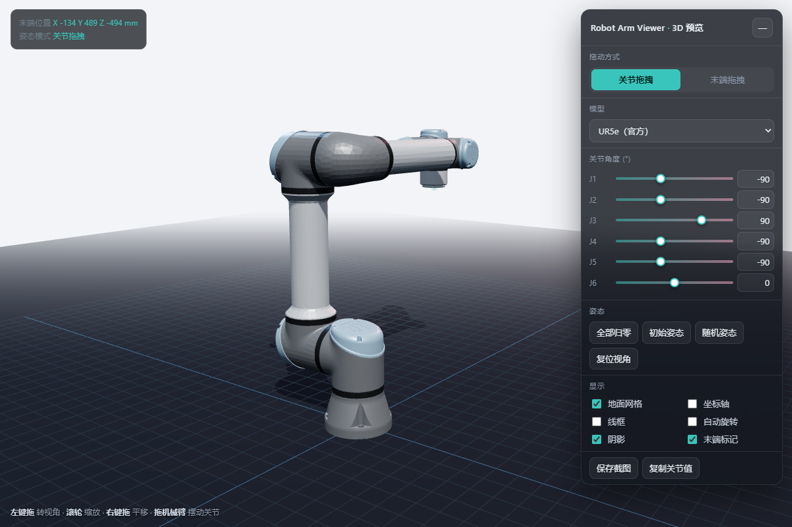

# Robot Arm Viewer

A single-page 3D viewer for robot arms. It reads **URDF + STL** directly in the browser:
drag joints, drag the end effector (position IK), switch display options, save screenshots.
No ROS, no RViz, no CAD, no build step.



## Quick start (Windows)

1. Download `RobotArmViewer-windows-x64.zip` from the [Releases](../../releases) page.
2. Unzip it anywhere.
3. Double-click **`Start Viewer.bat`**.

A console window opens and the browser goes to <http://127.0.0.1:8712/>.
The zip bundles a Node.js runtime, so nothing else has to be installed.

> Do not open `index.html` directly. Browsers block `fetch()` of local URDF/STL files
> (`file://`), so the page must be served over HTTP — that is what the `.bat` does.

## Features

- URDF joint tree with revolute / continuous / prismatic / fixed joints
- STL meshes (binary and ASCII), plus URDF `box` / `cylinder` / `sphere` primitives
- URDF material colors
- Joint sliders and numeric inputs; keyboard `1`–`6` to select, `Q` / `E` to nudge
- Drag a link to rotate its joint; drag the end effector to solve position IK
- Wireframe, joint axes, grid, shadows, auto-rotate
- Save a screenshot, copy the joint vector as JSON (degrees)

## Models

Two models ship with the viewer:

| Model | File | Notes |
| --- | --- | --- |
| UR5e (official) | `assets/urdf/ur5e.urdf` | default; meshes from MuJoCo Menagerie |
| Miku Arm (sample) | `assets/urdf/miku_dummy.urdf` | 6-DoF desktop arm |

Pick one in the **模型 / Model** dropdown, or pass it in the URL:

```
?urdf=assets/urdf/ur5e.urdf
?urdf=assets/urdf/miku_dummy.urdf
```

### Adding your own model

1. Put the URDF in `assets/urdf/` and the meshes in `assets/meshes/<name>/`.
2. Reference meshes as `package://arm_control/meshes/<name>/foo.stl`
   (`arm_control` is already mapped to `assets/` in `CFG.packageRoots`),
   or add your own package name in `app.js`:

   ```js
   packageRoots: { arm_control: 'assets', my_robot: 'assets/my_robot' }
   ```

3. Open `?urdf=assets/urdf/my_robot.urdf`.

Only STL meshes are supported for `mesh` geometry; DAE, glTF and xacro are not.

## URL parameters

| Parameter | Meaning |
| --- | --- |
| `?urdf=...` | model to load |
| `?q=0,-90,90,-90,-90,0` | initial joint angles in degrees |
| `?bg=f2f4f7` | light background (useful for screenshots) |
| `?selftest=1` | run the built-in IK/drag self-test, result in `<body data-test>` |
| `?dbg=1` | dump joint / mesh world coordinates to `<body data-dbg>` |

## Run from source

Requires Node.js 18 or newer.

```bash
node serve.mjs            # starts http://127.0.0.1:8712/ and opens the browser
node serve.mjs --no-open  # do not open a browser
node serve.mjs --port 9000
```

There are no npm dependencies: `three.js` is vendored in `vendor/`.

## Layout

```
index.html              page + styles
app.js                  URDF parser, STL parser, joint tree, drag, IK, UI
serve.mjs               tiny static server (zero dependencies)
start-viewer.bat        Windows launcher (uses runtime/node.exe when bundled)
assets/urdf/            URDF files
assets/meshes/          STL meshes
vendor/                 three.js r160 + OrbitControls
```

## License

The viewer code is released under the MIT License — see [LICENSE](LICENSE).

Bundled third-party components and models keep their own licenses;
see [THIRD_PARTY_NOTICES.md](THIRD_PARTY_NOTICES.md).
